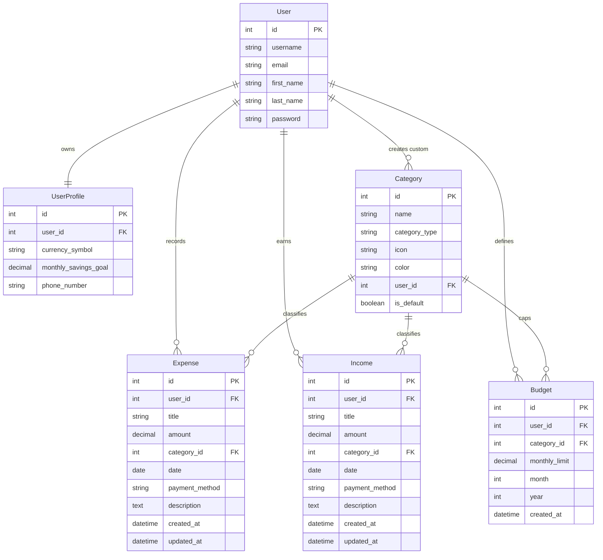

# PROJECT REPORT / DOCUMENTATION

---

## **PROJECT TITLE: ExpenseVault – Personal Finance & Expense Tracker**

- **Course:** SEM 5 - Python Framework (Django)
- **Architecture:** Model-View-Template (MVT) Pattern
- **Technology Stack:** Python 3.13, Django 6.1.2, SQLite3, HTML5, CSS3, JavaScript, Chart.js

---

## 1. ABSTRACT / PROJECT SUMMARY

**ExpenseVault** is a full-featured personal finance management web application developed using the Django Python framework. In the modern digital economy, personal expenditures occur across multiple digital and cash channels (UPI, Net Banking, Credit/Debit Cards, Cash), making it difficult for individuals to monitor their spending, identify financial leaks, and maintain monthly savings goals.

ExpenseVault addresses this issue by providing a centralized, secure platform where registered users can record and categorize their income and expenses, establish category-specific monthly budget caps, receive dynamic overspending alerts, visualize six-month cash-flow trends with interactive Chart.js charts, and export financial logs to standard CSV format. The project demonstrates core Django concepts including database modeling, migrations, custom forms with validation, model signals, session-based user authentication, view logic with ORM aggregations, and template inheritance.

---

## 2. PROBLEM STATEMENT

Managing day-to-day personal finances and maintaining monthly budgets without a dedicated tracking system poses several challenges:
1. **Lack of Visibility:** Individuals struggle to track total monthly expenditure distributed across multiple accounts and payment channels.
2. **Budget Overruns:** Without proactive warning indicators, users often exceed intended category budgets (such as dining, shopping, or entertainment) before month-end.
3. **No Historical Comparison:** Most manual tracking methods (spreadsheets or notebooks) do not easily generate comparative month-over-month income vs. expense analytics.
4. **Data Security & Privacy:** Financial data requires strict user isolation so that individual user records remain private and secure.

---

## 3. OBJECTIVES

The primary objectives of this project are:
1. **User Authentication & Multi-Tenancy:** Provide secure user registration, login, logout, and user profile management, ensuring strict isolation between user accounts.
2. **Income & Expense CRUD Operations:** Enable users to create, view, search, filter, edit, and delete transactions.
3. **Budget Tracking & Alerting:** Allow users to set category-level budget limits with automated visual status indicators (Safe, Approaching Limit, Over-Budget).
4. **Visual Analytics:** Provide interactive data visualizations (bar charts for 6-month trends and donut charts for monthly category distribution) powered by Chart.js.
5. **Data Portability:** Enable one-click CSV export of transaction data for external auditing or offline analysis.
6. **Code Reliability:** Implement automated unit tests validating models, views, signals, and security redirections.

---

## 4. TECHNOLOGIES & TOOLS USED

| Component | Technology / Tool | Purpose |
|---|---|---|
| **Programming Language** | Python 3.13 | Core backend programming |
| **Web Framework** | Django 6.1.2 | Full-stack MVT framework, ORM, Auth system |
| **Database** | SQLite3 | Relational database engine for persistent storage |
| **Frontend UI** | HTML5, CSS3 | Custom clean, simple & modern responsive light theme |
| **Icons & Typography** | Font Awesome 6.5.1, Plus Jakarta Sans | UI icons and typography |
| **Data Visualization** | Chart.js 4.x | Interactive client-side canvas charts |
| **Version Control** | Git & GitHub | Source code tracking and collaboration |
| **Testing Suite** | Django `TestCase` | Automated unit testing of models and views |

---

## 5. SYSTEM ARCHITECTURE & DESIGN

The project strictly follows Django's **Model-View-Template (MVT)** architecture:

```
[ User Browser / Client ]
           │
           ▼
     [ urls.py ] (URL Routing)
           │
           ▼
     [ views.py ] ◄───────► [ forms.py ] (Form Validation)
       │         ▲
       │         │ ORM Queries
       ▼         ▼
  [ models.py ] ◄───────► [ SQLite Database ]
       │
       ▼ (Context Data)
 [ templates/*.html ] (Jinja/Django Template Rendering)
       │
       ▼
[ HTTP Response with HTML/CSS/Chart.js ]
```

### Flow of Execution:
1. The user sends an HTTP request (e.g., to `/expenses/add/`).
2. `urls.py` parses the path and routes the request to `add_expense_view` in `tracker/views.py`.
3. The view verifies authentication via `@login_required`.
4. If a `POST` request is received, `ExpenseForm` validates inputs (amounts must be greater than zero, required fields must be present).
5. On valid submission, the record is saved to the SQLite database via Django ORM with `expense.user = request.user`.
6. A success message is added via `django.contrib.messages`, and the user is redirected to the expense list view.

---

## 6. DATABASE SCHEMA & DATA MODELS

The relational schema consists of 5 models defined in `tracker/models.py`:



### Model Descriptions:
- **`Category`**: Supports both Expense and Income types. Includes preset system categories (`is_default=True`) as well as user-customized categories.
- **`Expense`**: Stores individual expense transactions including amount, date, payment method (UPI, Cash, Debit Card, Credit Card, Net Banking), category foreign key, and optional notes.
- **`Income`**: Stores earnings and revenues with payment methods and category references.
- **`Budget`**: Enforces a `unique_together = ('user', 'category', 'month', 'year')` constraint so that a user cannot duplicate budget definitions for the same category within the same month.
- **`UserProfile`**: Linked to Django's built-in `User` via `OneToOneField`. Automatically initialized using a `post_save` signal whenever a new user registers.

---

## 7. IMPLEMENTATION DETAILS

### 7.1 Views & Business Logic (`tracker/views.py`)
The system implements 16 function-based views:
- `register_view`, `login_view`, `logout_view`: User authentication and session management.
- `dashboard_view`: Performs ORM aggregations (`Sum`) over the current calendar month and calculates the 6-month historical trend.
- `expense_list_view` / `income_list_view`: Implements search keyword matching (`Q(title__icontains=...) | Q(description__icontains=...)`), category filtering, payment method filtering, and date range constraints.
- `add_expense_view`, `edit_expense_view`, `delete_expense_view`: Transaction CRUD with user verification (`get_object_or_404(Expense, pk=pk, user=request.user)`).
- `budget_list_view`, `set_budget_view`, `delete_budget_view`: Compares total expenditures against monthly caps and assigns status flags (`safe`, `warning`, `danger`).
- `analytics_reports_view`: Generates annual accumulation statistics and 12-month tables.
- `export_expenses_csv`, `export_incomes_csv`: Uses Python's built-in `csv` module to stream CSV file responses with dynamic filenames.
- `seed_demo_data_view`: Seeds sample categories, transactions, and budgets for immediate demonstration.

### 7.2 Form Handling & Validation (`tracker/forms.py`)
- `UserRegistrationForm`: Enforces password confirmation matching and email uniqueness validation.
- `ExpenseForm` & `IncomeForm`: Dynamic queryset filtering ensures that users can only select categories they own or default system categories. Includes custom `clean_amount` methods ensuring `amount > 0`.
- `BudgetForm`: Validates numeric month (1–12) and year bounds.

### 7.3 Frontend & Design System
- Built on a clean, simple, modern light CSS design system with custom CSS variables (`--bg-app: #f8fafc`, `--bg-card: #ffffff`, `--accent-primary: #4f46e5`).
- Features high-contrast readable typography, subtle borders, clean card elevations, and a clean, simple light side navigation bar.
- All forms are protected against CSRF attacks with ``.

---

## 8. TESTING & QUALITY ASSURANCE

Automated unit tests are implemented in `tracker/tests.py` using Django's `TestCase` framework:

```python
# Test Summary (from 'python manage.py test tracker')
Found 8 test(s).
System check identified no issues (0 silenced).
........
----------------------------------------------------------------------
Ran 8 tests in 13.270s

OK
```

### Test Coverage Details:
1. **`test_category_creation`**: Validates `Category` model string representation and attributes.
2. **`test_expense_creation`**: Validates `Expense` model creation, field types, and Decimal precision.
3. **`test_income_creation`**: Validates `Income` record insertion.
4. **`test_user_profile_signal`**: Verifies that the `post_save` signal successfully creates a `UserProfile` whenever a new `User` is registered.
5. **`test_unauthenticated_dashboard_redirects`**: Confirms unauthenticated access to protected routes returns HTTP 302 redirecting to `/login/`.
6. **`test_authenticated_dashboard_access`**: Confirms authenticated users receive HTTP 200 with the `tracker/dashboard.html` template.
7. **`test_add_expense_post`**: Tests form submission and database insertion for new expenses.
8. **`test_csv_export`**: Verifies that the export endpoint returns HTTP 200 with `Content-Type: text/csv` and appropriate attachment headers.

---

## 9. USER INTERFACE & FUNCTIONALITY SCREENSHOTS (PLACEHOLDERS)

*(Include the following screenshots in your final submission document)*

1. **Figure 1: User Registration & Authentication (`/register/` & `/login/`)**  
   *Caption: Secure registration form with validation and login interface.*

2. **Figure 2: Financial Dashboard (`/`)**  
   *Caption: Main dashboard showcasing total monthly income, expenses, net savings, budget alerts, 6-month trend bar chart, and category donut chart.*

3. **Figure 3: Expense Management & Multi-Filter Table (`/expenses/`)**  
   *Caption: Comprehensive listing of expenditures with keyword search, category, payment method, and date filters.*

4. **Figure 4: Add New Expense Form (`/expenses/add/`)**  
   *Caption: Modal/Page form demonstrating Django ModelForm integration and category select.*

5. **Figure 5: Category Budgets Tracking (`/budgets/`)**  
   *Caption: Visual monthly budget meters showing color-coded progress bars (safe, warning, over-budget).*

6. **Figure 6: Annual Analytics & Financial Reports (`/reports/`)**  
   *Caption: 12-month financial breakdown table and spending by payment channel.*

---

## 10. CONCLUSION & FUTURE ENHANCEMENTS

### 10.1 Conclusion
The ExpenseVault project satisfies all academic requirements specified in the project guidelines. It demonstrates practical mastery of:
- Django project and application architecture (`startproject`, `startapp`).
- Model relationships (`ForeignKey`, `OneToOneField`) and database migrations.
- Secure user authentication and session management.
- Dynamic template rendering with custom CSS styling and responsive layout.
- Data aggregation and reporting via Django ORM.
- Automated testing verifying system stability.

### 10.2 Future Enhancements
Potential future extensions for production deployment include:
1. **Recurring Transactions:** Automating monthly recurring bills and subscriptions.
2. **Email Alerts & Summaries:** Sending automated monthly PDF statements using Django's email backend.
3. **Receipt Attachment:** Adding image upload support (`ImageField`) for receipt scanning and storage.
4. **REST API Integration:** Exposing endpoints via Django REST Framework (DRF) for integration with mobile clients (Flutter/React Native).
5. **Multi-Currency Conversion:** Integrating third-party exchange rate APIs for real-time currency conversion.
