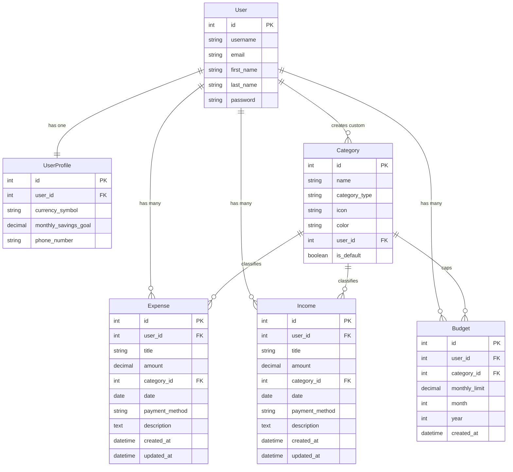

# ExpenseVault — Personal Finance & Expense Tracker

A modern, full-featured personal expense and income tracking web application built with **Python 3.13** and **Django 6.1.2**. Features a clean, simple light UI, category-wise monthly budget management, automated budget warning alerts, interactive data visualizations (Chart.js), CSV data export, and complete user authentication.

---

## 📋 Table of Contents
- [Project Overview](#-project-overview)
- [Key Features](#-key-features)
- [Technologies & Tools](#-technologies--tools)
- [System Architecture](#-system-architecture)
- [Database Schema](#-database-schema)
- [Getting Started / How to Run](#-getting-started--how-to-run)
- [Running Automated Tests](#-running-automated-tests)
- [Project Directory Structure](#-project-directory-structure)
- [Submission Deliverables](#-submission-deliverables)

---

## 🎯 Project Overview

Managing daily expenditures across digital payment methods (UPI, debit/credit cards, net banking) and cash is often disorganized. **ExpenseVault** solves this by providing:
1. Strict user-isolated financial tracking (each user sees only their own data).
2. Category-wise budget caps with real-time threshold warnings (Safe, Approaching Limit, Over-Budget).
3. 6-month comparative cash flow trends and current month expense distribution charts.
4. One-click CSV spreadsheet export for offline analysis.

---

## ✨ Key Features

- **🔐 User Management & Security:**
  - Secure registration, login, logout with Django session management.
  - Route protection using `@login_required` decorators.
  - User profile management with customizable currency symbols (₹, $, €) and monthly savings targets.
  - CSRF protection enabled across all forms.

- **💸 Transaction Management (Full CRUD):**
  - Add, view, edit, and delete both Expenses and Incomes.
  - Filter by date range, category, payment method (UPI, Cash, Debit Card, Credit Card, Net Banking), and search keywords.

- **🎯 Category Budget Tracking:**
  - Set monthly spending caps for individual categories (Food, Groceries, Travel, Entertainment, etc.).
  - Real-time progress bars and dashboard alerts when spending reaches 80% or exceeds 100%.

- **📊 Visual Analytics (Chart.js):**
  - **Bar Chart:** 6-month historical income vs. expense cash flow.
  - **Donut Chart:** Monthly breakdown of expenses by category.

- **📥 Data Export:**
  - One-click CSV download for all logged expenses and incomes.

- **🪄 Demonstration Data Seeder:**
  - Built-in one-click button to populate realistic sample transactions and budgets for immediate demonstration.

---

## 🛠️ Technologies & Tools

- **Backend:** Python 3.13, Django 6.1.2 (MVT Architecture)
- **Database:** SQLite3 with Django ORM
- **Frontend:** HTML5, CSS3 (Simple Clean Light Theme), JavaScript
- **Icons & Fonts:** Font Awesome 6.5.1, Inter
- **Charts:** Chart.js 4.x
- **Testing:** Django `TestCase` (8 automated test cases)

---

## 🏗️ System Architecture

The application strictly adheres to Django's **Model-View-Template (MVT)** architectural design pattern:

```
[ Web Browser ]
      │
      ▼ (HTTP Request)
[ urls.py ] ──────────► [ views.py ] ◄──────────► [ forms.py ]
                             │   ▲
                  ORM Query  │   │ Data Objects
                             ▼   │
                        [ models.py ] ◄──────────► [ SQLite Database ]
                             │
                             ▼ (Context Data)
                     [ templates/*.html ]
                             │
                             ▼ (Rendered HTML/CSS/Chart.js)
                      [ HTTP Response ]
```

---

## 🗄️ Database Schema

The database consists of 5 related relational models:



---

## 🚀 Getting Started / How to Run

### 1. Clone the repository
```bash
git clone https://github.com/<YOUR-USERNAME>/expense-vault-django.git
cd expense-vault-django
```

### 2. Install dependencies
```bash
pip install -r requirements.txt
```

### 3. Apply database migrations
```bash
python manage.py migrate
```

### 4. Create an Admin / Superuser (Optional)
```bash
python manage.py createsuperuser
```

### 5. Start the development server
```bash
python manage.py runserver
```

### 6. Open in Browser
Visit **[http://127.0.0.1:8000/](http://127.0.0.1:8000/)** in your browser:
- Click **"Create One Here"** to register a new account.
- Once logged in, click **"Demo Data"** in the top navigation bar to populate sample transactions and view the charts immediately!

---

## 🧪 Running Automated Tests

Run the built-in test suite to verify models, views, and authentication:

```bash
python manage.py test tracker
```

Expected output:
```text
Found 8 test(s).
System check identified no issues (0 silenced).
........
----------------------------------------------------------------------
Ran 8 tests in 5.820s

OK
```

---

## 📁 Project Directory Structure

```text
Python Framework/
│
├── expensetracker_project/      # Project settings and root routing
│   ├── __init__.py
│   ├── asgi.py
│   ├── settings.py              # Installed apps, DB, templates, static config
│   ├── urls.py                  # Root URL configuration
│   └── wsgi.py
│
├── tracker/                     # Main Application
│   ├── migrations/              # Database schema migrations
│   ├── __init__.py
│   ├── admin.py                 # Django admin registration & customizations
│   ├── apps.py
│   ├── forms.py                 # Form validation (Expense, Income, Budget, Auth)
│   ├── models.py                # Database models (Category, Expense, Income, Budget, UserProfile)
│   ├── seed_data.py             # Realistic demonstration data generator
│   ├── tests.py                 # 8 automated unit tests
│   ├── urls.py                  # App URL patterns
│   └── views.py                 # 16 business logic views
│
├── templates/                   # HTML Templates (Django Template Language)
│   ├── base.html                # Base layout with simple top navbar & footer
│   ├── auth/
│   │   ├── login.html           # Login page
│   │   └── register.html        # Registration page
│   └── tracker/
│       ├── budget_form.html     # Set budget form
│       ├── budget_list.html     # Monthly category budgets view
│       ├── confirm_delete.html  # Generic delete confirmation
│       ├── dashboard.html       # Dashboard with Chart.js charts
│       ├── expense_form.html    # Add/Edit expense form
│       ├── expense_list.html    # Filterable expenses table
│       ├── income_form.html     # Add/Edit income form
│       ├── income_list.html     # Filterable income table
│       ├── profile.html         # User settings & profile
│       └── reports.html         # 12-month analytics & payment breakdown
│
├── static/                      # Static Assets
│   └── css/
│       └── styles.css           # Clean simple light theme stylesheet
│
├── .gitignore                   # Ignored files for Git
├── manage.py                    # Django management CLI utility
├── PROJECT_REPORT.md            # Complete academic project report / documentation
├── README.md                    # Project documentation (this file)
└── requirements.txt             # Project Python dependencies
```

---

## 📦 Submission Deliverables

As per project guidelines:
1. **Source Code:** Uploaded to GitHub repository.
2. **One-page Summary:** Available in Section 1 of `PROJECT_REPORT.md`.
3. **Full Project Report:** Complete document ready in `PROJECT_REPORT.md`.
4. **Testing Results:** 8 unit test cases passing (`python manage.py test tracker`).
5. **Demonstration & Viva:** Ready with sample data via the **"Demo Data"** button.

---

## 📄 License
This project is developed for educational purposes as part of Semester 5 Python Web Framework coursework.

